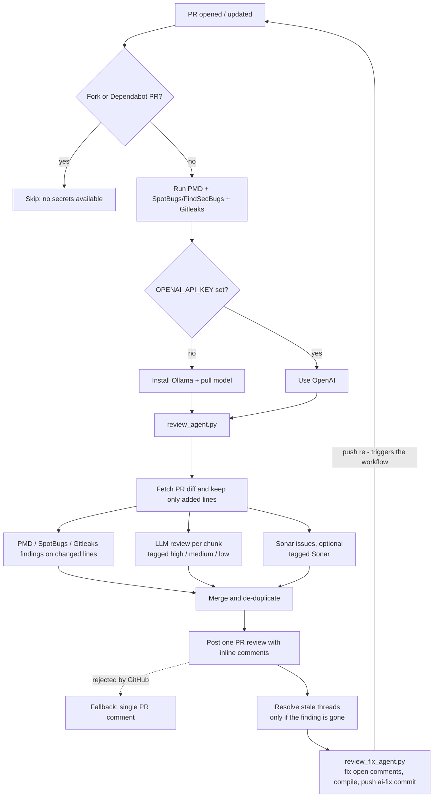

# AI PR Reviewer

Reviews every pull request and posts **inline comments on the changed lines**.

## Flow

## Where a comment comes from

| Comment starts with                       | Source                                                                                  |
|-------------------------------------------|-----------------------------------------------------------------------------------------|
| `**[Static analysis]**`                   | PMD rules in `pmd-ruleset.xml` (fixed, rule-based)                                      |
| `**[Security/bug analysis]**`             | SpotBugs + FindSecBugs on compiled code (SQL injection, path traversal, resource leaks) |
| `**[Secret scan]**`                       | Gitleaks (secret values are redacted)                                                   |
| `**[high]**`, `**[medium]**`, `**[low]**` | LLM (Ollama or OpenAI): design, SOLID, security, bugs                                   |
| `**[Sonar ...]**`                         | SonarCloud/SonarQube, only if `SONAR_TOKEN` and `SONAR_PROJECT_KEY` are set             |

## Files

| File                                   | Purpose                                                   |
|----------------------------------------|-----------------------------------------------------------|
| `.github/workflows/ai-pr-reviewer.yml` | Triggers on PRs, runs PMD, sets up Ollama, runs the agent |
| `docs/agent/review_agent.py`           | Parses the diff, calls the LLM, posts the review          |
| `docs/agent/review_fix_agent.py`       | Fixes open comments, compiles, pushes an `ai-fix:` commit |
| `docs/agent/pmd-ruleset.xml`           | Java, Spring Boot, SOLID and layering rules               |

## Configuration

| Setting                                                | Default            | Notes                                     |
|--------------------------------------------------------|--------------------|-------------------------------------------|
| `OPENAI_API_KEY` (secret)                              | not set            | If set, OpenAI is used; otherwise Ollama  |
| `OPENAI_MODEL`                                         | `gpt-4o`           |                                           |
| `OLLAMA_MODEL`                                         | `qwen2.5-coder:3b` | Use `qwen2.5-coder:3b` for better quality |
| `SONAR_TOKEN` / `SONAR_PROJECT_KEY` / `SONAR_HOST_URL` | not set            | Optional Sonar issues                     |

## Stale comments

After posting the review, the agent looks at its own review threads that GitHub marks **outdated** (the commented code
changed or was removed). If the finding is **gone** (no new comment with the same rule or text within 10 lines), it
replies with a one-sentence LLM note (`✅ Resolved: ...`) and resolves the thread. If the finding is **still reported**,
the old thread stays open and the new review comments on the new code. Unchanged code keeps its open thread. At most 30
threads are handled per run.

**Setup:** GitHub does not let the default `GITHUB_TOKEN` resolve threads or trigger new runs on push, so the workflow
mints a short-lived GitHub App token (`actions/create-github-app-token`) from the variable `APP_ID` and the secret
`APP_PRIVATE_KEY` (same as `dependency-update.yml`). The app must be installed on this repo with **Pull requests: Read
and write** and **Contents: Read and write**. Without it the agent logs a hint, leaves threads open and skips auto-fix.

## Auto-fix

`review_fix_agent.py` runs after the review:

1. Takes up to 5 open, current bot comments on `.java` files (secret findings are skipped, they need a human).
2. Asks the model for a replacement of the flagged **single line** and runs `mvn compile`; fixes that do not compile
   are reverted.
3. Commits `ai-fix: ...` and pushes with the app token, which re-triggers the workflow. The next run re-checks the code:
   fixed findings are resolved, remaining ones are kept and commented again.

Safety limits: at most 2 `ai-fix:` rounds per PR, 120 s model budget (`FIX_TIME_BUDGET`), 4 min step timeout. Multi-line
problems (for example try-with-resources) are left for a human.

## Limits

- Large diffs are split by file into chunks. Ollama reviews at most 2 chunks of about 5k characters, OpenAI at most 5
  chunks of about 100k characters.
- Speed: the tools and the Ollama setup run in parallel, and the model gets a time budget (`REVIEW_TIME_BUDGET`, default
  150 s). Chunks left after the budget are not reviewed by the model and the review says so. Stale-thread notes use the
  generic text once a quarter of the budget is spent. The job is capped at 14 minutes (the fix step is capped at 4).
- Lockfiles, binaries, `docs/`, `.github/` (workflows) and `*.md` files are ignored.
- CPU-only Ollama on GitHub runners is slow, and small models give shallower reviews.
