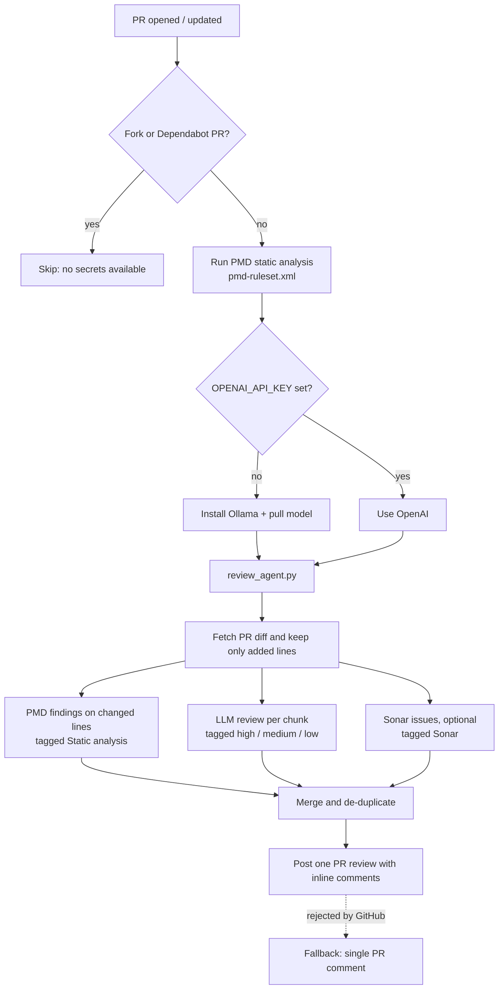

# AI PR Reviewer

Reviews every pull request and posts **inline comments on the changed lines**.

## Flow

## Where a comment comes from

| Comment starts with                       | Source                                                                      |
|-------------------------------------------|-----------------------------------------------------------------------------|
| `**[Static analysis]**`                   | PMD rules in `pmd-ruleset.xml` (fixed, rule-based)                          |
| `**[high]**`, `**[medium]**`, `**[low]**` | LLM (Ollama or OpenAI): design, SOLID, security, bugs                       |
| `**[Sonar ...]**`                         | SonarCloud/SonarQube, only if `SONAR_TOKEN` and `SONAR_PROJECT_KEY` are set |

## Files

| File                                   | Purpose                                                   |
|----------------------------------------|-----------------------------------------------------------|
| `.github/workflows/ai-pr-reviewer.yml` | Triggers on PRs, runs PMD, sets up Ollama, runs the agent |
| `docs/agent/review_agent.py`           | Parses the diff, calls the LLM, posts the review          |
| `docs/agent/pmd-ruleset.xml`           | Java, Spring Boot, SOLID and layering rules               |

## Configuration

| Setting                                                | Default              | Notes                                     |
|--------------------------------------------------------|----------------------|-------------------------------------------|
| `OPENAI_API_KEY` (secret)                              | not set              | If set, OpenAI is used; otherwise Ollama  |
| `OPENAI_MODEL`                                         | `gpt-4o`             |                                           |
| `OLLAMA_MODEL`                                         | `qwen2.5-coder:1.5b` | Use `qwen2.5-coder:3b` for better quality |
| `SONAR_TOKEN` / `SONAR_PROJECT_KEY` / `SONAR_HOST_URL` | not set              | Optional Sonar issues                     |

## Limits

- Large diffs are split by file into chunks. Ollama reviews at most 3 chunks of about 6k characters, OpenAI at most 5
  chunks of about 100k characters.
- Lockfiles, binaries, `docs/` and `*.md` files are ignored.
- CPU-only Ollama on GitHub runners is slow, and small models give shallower reviews.
