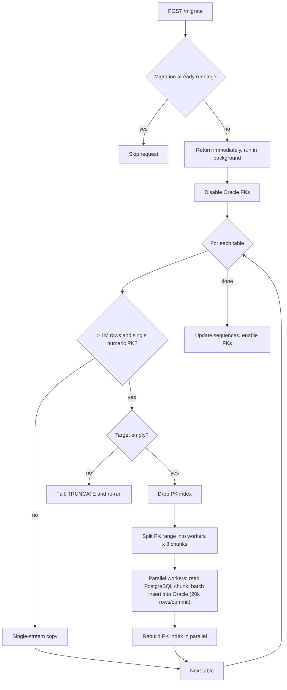

# PostgreSQL → Oracle migration

`POST /api/oracle-tools/migrate` copies data from PostgreSQL into **empty, pre-created** Oracle tables over JDBC.
No DBA action, shared storage or extra tool is needed. The call returns immediately and the migration runs in the
background; follow the logs.

## How it works



| Table                                       | Flow                                                                            |
|---------------------------------------------|---------------------------------------------------------------------------------|
| Large (> 1M rows, single `int`/`bigint` PK) | Chunked parallel copy; optional PK index drop before and parallel rebuild after |
| Everything else                             | Single-stream copy                                                              |

## Request fields

| Field                   | Default    | Meaning                                                 |
|-------------------------|------------|---------------------------------------------------------|
| `source`, `destination` | required   | JDBC connection configs                                 |
| `tableSchemaMap`        | –          | Which tables go to which Oracle schema                  |
| `chunkWorkers`          | `6` (1–24) | Parallel workers, shared by all tables in the request   |
| `rebuildPrimaryKeys`    | `true`     | Drop the target PK index before the load, rebuild after |

## Before running

- Target tables exist and are **empty** (`TRUNCATE` if a previous run failed).
- The app user owns the target tables (needed for the PK drop/rebuild).
- Oracle TEMP has room for the PK index sort; redo/archive log space can hold roughly the data size.
- JVM options: see [JVM / GC options](#jvm--gc-options).
- Only one migration runs at a time; a second request is skipped.

## JVM / GC options

Recommended: `-XX:InitialRAMPercentage=75 -XX:MaxRAMPercentage=75 -XX:+UseG1GC`

The GC frees memory of objects no longer used. The migration creates millions of short-lived row objects, so the GC must
be parallel and have short pauses. G1 is the default on JDK 9+ for machines with 2+ CPUs and ~1.8 GB+ RAM, but small
containers can fall back to Serial, so set it explicitly.

| GC (Java 25+)      | Flag                                                     | Use for this migration                                                                                 |
|--------------------|----------------------------------------------------------|--------------------------------------------------------------------------------------------------------|
| **G1** (default)   | `-XX:+UseG1GC`                                           | **Recommended.** Balanced, predictable pauses, good with 6+ GB heap.                                   |
| Parallel           | `-XX:+UseParallelGC`                                     | Highest raw throughput, but long pauses on big heaps. Acceptable, not needed.                          |
| Serial             | `-XX:+UseSerialGC`                                       | Single thread. **Avoid**: it slows the workers.                                                        |
| ZGC (generational) | `-XX:+UseZGC`                                            | Near-zero pauses, more CPU/memory overhead. Not needed here (non-generational mode removed in JDK 24). |
| Shenandoah         | `-XX:+UseShenandoahGC -XX:ShenandoahGCMode=generational` | Low pauses; generational mode is a product feature in JDK 25. Not needed here.                         |

Java 25 notes:

- `-XX:+UseCompactObjectHeaders` is a product flag in JDK 25 (smaller objects, less GC work). No experimental unlock
  needed.
- CMS no longer exists; do not use it.
- Prefer one GC flag only; the JVM refuses to start with two.

## Trigger

```bash
curl -X POST "http://localhost:8080/api/oracle-tools/migrate" \
  -H "Content-Type: application/json" \
  -d '{
    "source":      { "jdbcUrl": "jdbc:postgresql://pg-host:5432/db", "username": "...", "password": "...", "schema": "public" },
    "destination": { "jdbcUrl": "jdbc:oracle:thin:@//ora-host:1521/SVC", "username": "...", "password": "...", "schema": "TARGET" },
    "tableSchemaMap": { "TARGET": ["big_table_1"] },
    "chunkWorkers": 12
  }'
```

## If something fails

| Message                                               | Action                             |
|-------------------------------------------------------|------------------------------------|
| `... must be truncated before re-running`             | `TRUNCATE` the target and re-run   |
| `Target table ... is not empty`                       | `TRUNCATE` the target and re-run   |
| `Failed to rebuild primary key ... Run manually: ...` | Data is loaded; run the logged SQL |
