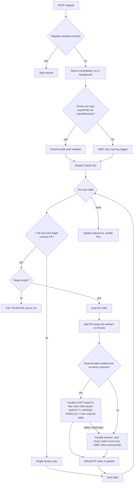

# PostgreSQL → Oracle migration

`POST /api/oracle-tools/migrate` copies data from PostgreSQL into **empty, pre-created** Oracle tables.
The call returns immediately and the migration runs in the background; follow the logs.

Two load paths, chosen automatically per table:

| Path                | When                                                         | Needs                                            |
|---------------------|--------------------------------------------------------------|--------------------------------------------------|
| **External table**  | Large table, Oracle can read the export files                | One-time DBA `CREATE DIRECTORY` + shared storage |
| **JDBC chunk copy** | Fallback for large tables, and always for small/other tables | Nothing                                          |

If the DBA setup is missing or fails, the migration logs a warning and uses the JDBC path. It never fails because of it.

## How it works



- External path: all rows load in **one transaction**, so the target is either fully loaded or still empty. Export files
  and the external table are removed afterwards.
- JDBC path: every row belongs to exactly one chunk; a failed run must be truncated before re-running.

## Request fields

| Field                   | Default          | Meaning                                                                                          |
|-------------------------|------------------|--------------------------------------------------------------------------------------------------|
| `source`, `destination` | required         | JDBC connection configs                                                                          |
| `tableSchemaMap`        | –                | Which tables go to which Oracle schema                                                           |
| `chunkWorkers`          | `6` (1–24)       | Parallel export/copy workers, shared by all tables in the request                                |
| `rebuildPrimaryKeys`    | `true`           | Drop the target PK index before the load, rebuild in parallel after                              |
| `oracleDirectory`       | `MIG_DIR`        | Oracle DIRECTORY used by the external table. Blank = JDBC only                                   |
| `exportPath`            | `/mnt/migration` | Where this service writes export files (same storage the DIRECTORY points to). Blank = JDBC only |

## One-time DBA setup (only for the fast external table path)

```sql
CREATE
OR REPLACE DIRECTORY MIG_DIR AS '/mnt/migration';   -- path as seen by the Oracle server
GRANT READ, WRITE
ON DIRECTORY MIG_DIR TO <app_user>;
```

`/mnt/migration` must be the **same shared storage** (NFS or similar) mounted on both this service and the Oracle
server.
Disk: roughly the CSV size of the largest table (≈ 150–400 GB per 2B rows); files are deleted after each table.
Without a shared mount, skip this: the JDBC path is used.

## Before running

- Target tables exist and are **empty** (`TRUNCATE` if a previous run failed).
- The app user owns the target tables (needed for the PK drop/rebuild).
- Oracle TEMP has room for the PK index sort (~40–80 GB per 2B-row table).
- JDBC path only: redo/archive log space can hold roughly the data size. The external path uses direct-path, which
  generates much less redo.
- The PostgreSQL URL gets `prepareThreshold=-1` (binary transfer) automatically; put `prepareThreshold=0` in the URL to
  opt out (e.g. PgBouncer transaction mode).
- JVM options: see [JVM / GC options](#jvm--gc-options).
- Only one migration runs at a time; a second request is skipped.

## Time estimate per 2B-row table (8-core Oracle, 12–16 workers)

Estimates, not measurements. Take two `Progress:` log lines 10 minutes apart to get the real rate.

| Path           | Load                                | PK rebuild | Total per table |
|----------------|-------------------------------------|------------|-----------------|
| External table | export ~30–60 min + load ~30–60 min | 15–30 min  | **≈ 1.2–2.2 h** |
| JDBC chunk     | ~1.7–2.5 h                          | 15–30 min  | ≈ 2–3 h         |

The external path is limited by export speed (PostgreSQL + network/storage write) and Oracle direct-path parallelism, so
more `chunkWorkers` help up to ~16.
Four 2B-row tables run one after another: external ≈ 5–9 h, JDBC ≈ 8–12 h.

## JVM / GC options

Recommended: `-XX:InitialRAMPercentage=75 -XX:MaxRAMPercentage=75 -XX:+UseG1GC`

The GC frees memory of objects no longer used. The migration creates millions of short-lived row objects, so the GC must
be parallel and have short pauses. G1 is the default on JDK 9+ for machines with 2+ CPUs and ~1.8 GB+ RAM, but small
containers can fall back to Serial, so set it explicitly.

| GC (Java 25+)      | Flag                                                     | Use for this migration                                                                                 |
|--------------------|----------------------------------------------------------|--------------------------------------------------------------------------------------------------------|
| **G1** (default)   | `-XX:+UseG1GC`                                           | **Recommended.** Balanced, predictable pauses, good with 6+ GB heap.                                   |
| Parallel           | `-XX:+UseParallelGC`                                     | Highest raw throughput, but long pauses on big heaps. Acceptable, not needed.                          |
| Serial             | `-XX:+UseSerialGC`                                       | Single thread. **Avoid**: it slows the workers.                                                        |
| ZGC (generational) | `-XX:+UseZGC`                                            | Near-zero pauses, more CPU/memory overhead. Not needed here (non-generational mode removed in JDK 24). |
| Shenandoah         | `-XX:+UseShenandoahGC -XX:ShenandoahGCMode=generational` | Low pauses; generational mode is a product feature in JDK 25. Not needed here.                         |

Java 25 notes:

- `-XX:+UseCompactObjectHeaders` is a product flag in JDK 25 (smaller objects, less GC work). No experimental unlock
  needed.
- CMS no longer exists; do not use it.
- Prefer one GC flag only; the JVM refuses to start with two.

## Trigger

```bash
curl -X POST "http://localhost:8080/api/oracle-tools/migrate" \
  -H "Content-Type: application/json" \
  -d '{
    "source":      { "jdbcUrl": "jdbc:postgresql://pg-host:5432/db", "username": "...", "password": "...", "schema": "public" },
    "destination": { "jdbcUrl": "jdbc:oracle:thin:@//ora-host:1521/SVC", "username": "...", "password": "...", "schema": "TARGET" },
    "tableSchemaMap": { "TARGET": ["big_table_1"] },
    "chunkWorkers": 16,
    "oracleDirectory": "MIG_DIR",
    "exportPath": "/mnt/migration"
  }'
```

## Logs to look for

```
External table load enabled (directory: MIG_DIR, export path: /mnt/migration).   <- fast path active
External table load not available, using JDBC copy ... Reason: ...               <- fallback
Exported 2000000000 rows of public.big_table_1 into 128 files in 2400s. Loading ...
Loaded 2000000000 rows into TARGET.BIG_TABLE_1 in 2100s.
Progress: 120000000 records (250000 records/sec)
Rebuilt primary key PK_BIG_TABLE_1 on TARGET.BIG_TABLE_1 in 1200s.
```

## If something fails

| Message                                               | Action                                                                 |
|-------------------------------------------------------|------------------------------------------------------------------------|
| `External table load of ... failed, falling back`     | Nothing: the external load was rolled back and the JDBC copy continues |
| `... must be truncated before re-running`             | `TRUNCATE` the target and re-run                                       |
| `Target table ... is not empty`                       | `TRUNCATE` the target and re-run                                       |
| `Failed to rebuild primary key ... Run manually: ...` | Data is loaded; run the logged SQL (usually after freeing TEMP space)  |

